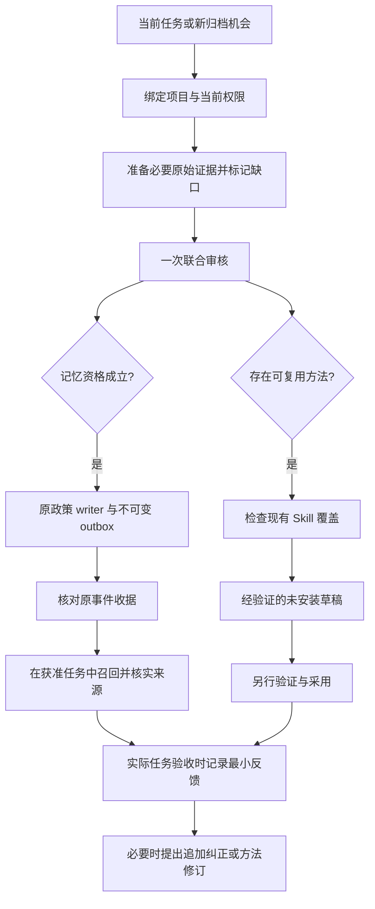

# Bounded Agent Memory｜有边界的 Agent 记忆策略

让 Agent 在新对话中找得到讨论、核对得了结论、复用得了方法，并在证据不足时保留不确定性。

这份仓库整理了一套在 Codex 与 DSH（DeepSeek Harness）协作环境中逐步形成的记忆策略。重点是任务连续性、证据可追溯和可靠执行，也保留尚未定论的讨论入口。人格连续性与执行可靠性可以共存；本方案目前没有实现人格自述、按聊天频率塑造人设或自动遗忘。

**发布范围：策略说明、脱敏参考模板、合成样例与验收清单。** 当前没有打包可直接安装的 MCP 服务、归档控制器或生产部署脚本。复制文档不会自动启用任何功能。

整理日期：2026-11-10。部署与测试说明依据截至 2026-11-06 的本地验收记录；这不是 11 月 10 日的服务健康检查。

## 为什么这样设计

只保存结论，会漏掉“我们好像讨论过，但还没定”的线索；保存全部聊天，又容易把猜测、过期约束和当前事实混在一起。我们按资料的用途和可信程度分工：

| 需要记住什么 | 使用什么载体 | 使用时注意什么 |
| --- | --- | --- |
| 讨论过的方向、候选方案、未决问题 | Notion 项目页、讨论记录 | 明确标注提议、已确认、否决、待验证；讨论发生过不代表结论成立 |
| 已确认、可复用的事实和经验 | Hindsight 长期记忆 | 绑定项目、来源、条件和版本；重要复用前查原始来源 |
| 完整证据和实际产物 | 原始会话、项目文件、版本历史 | 摘要和索引不能替代原件；不要为记忆而复制全部会话 |
| 当前目标、待办和接续信息 | 当前上下文、必要的有界交接 | 用于继续任务，不自动升级为长期事实 |
| 可以重复执行的方法 | 现有流程、runbook、经过验证的 Skill | 先检查已有覆盖；新草稿不等于已安装 |
| 明确获准的文档集合检索 | RAGFlow 等文档检索工具 | 显式指定获准的数据集，不能默认检索所有资料 |

Notion 已承担讨论记录的角色。本轮没有新增第二个“讨论记忆库”，也没有验证一条对所有聊天自动生效的 Notion 写入/召回管线。

## 如何运行

审核可以得出“不存”“证据不足”或“已有覆盖”。没有记忆写入配额，也不要求每轮对话保存一次。

## 存入、召回与反馈

- **存入**：在有可复用成果、明确决定、经验证的恢复经验或绑定交接的任务/阶段结束时，顺手审查最小候选；只有全部资格成立才追加。
- **召回**：先用当前上下文和权威项目文件。缺历史证据时再按类型路由：讨论查 Notion；结论查 Hindsight；详细证据查原件；操作方法查现有流程/Skill。
- **核实**：项目身份、条件、版本、权限和冲突先于语义相似度。重要使用必须补齐缺失的原始限制或修订。
- **反馈**：确实使用记忆或 Skill 并完成任务验收时，把最小反馈放在原验收报告旁；不逐轮跟踪，不自动改写记忆。

详见 [架构](docs/architecture.md)、[存入与召回](docs/retention-and-recall.md)、[归档与 Skill 联合审核](docs/archive-review.md)。

## 本地部署配置快照

以下仅是一个已获授权项目的工程配置，不是通用默认授权：

| 项目 | 配置或边界 |
| --- | --- |
| 手动归档检测 | 每 12 小时一次，00:00 / 12:00，Asia/Singapore |
| 普通归档 worker | 每个新加坡日最多启动 10 项，单并发、单写者 |
| 记忆与 Skill | 共用同一次审核、同一每日额度 |
| 来源材料 | 累计至多 32 个唯一正文 turn、32768 UTF-8 字节；seed、历史元数据页、补读正文共同计数 |
| 不在来源预算内 | 控制状态/核验元数据、提示包装、模型内部请求和 tokens |
| 本地等待 | worker 300 秒；服务 90 分钟；不保证远端已终止或停止计费 |
| 结果未知 | 保留 unknown fence，停止后续准入，不自动重试原版本 |
| Skill | 仅经验证的未安装草稿；不自动启用 |

**模型内部请求数和 tokens 没有可验证的硬上限。** 不能把 32KiB 来源限制、10 次启动限制或本地超时解释为费用硬上限。

## 已验证到哪里

本地验收记录包含 66 项离线机械检查、SDK stdio/重启预算检查，以及一次最终通过的原生合成工具链试跑。前置失败仍作为失败保留。服务加载与空闲检查通过。

这些结果没有证明真实新增归档到长期记忆/Skill 的完整生产链路普遍成功，也没有证明长期召回质量、用户体验或 token/时间节省。原始验收日志含本机信息，未随仓库公开；上述属于经过来源核对的结果摘要，不是可在本仓库独立重跑的测试套件。完整边界见 [验证与采用状态](docs/validation-and-status.md)。

## 从哪里开始

1. 阅读 [架构与五层职责](docs/architecture.md)，确定现有工具各自负责什么。
2. 参考 [政策模板](templates/POLICY.example.md)，绑定自己的项目、writer、来源保存和未知结果恢复机制。
3. 用 [合成场景](examples/scenarios.md) 和 [验收清单](docs/validation-and-status.md) 检查会漏掉什么。
4. 先验证离线与隔离路径，再单独授权部署；不要直接复制别人的银行、路径、权限或定时器。

配置字段示例见 [archive-profile.example.json](templates/archive-profile.example.json)。它只是说明性数据，不是某个工具可直接读取的配置格式。

## 公开内容与许可

本仓库没有上传私人聊天、记忆条目、Notion 正文、凭证、实际 bank/owner 标识、事件 ID、机器路径、服务地址或生产数据库。示例均为合成数据；策略说明是重新整理的公开表达，没有直接分发私人治理源文件。

当前未指定开源许可证。仓库公开可阅读，不代表已授予额外再分发或使用许可。第三方工具各自遵循其原许可；本仓库不代表其官方方案。
