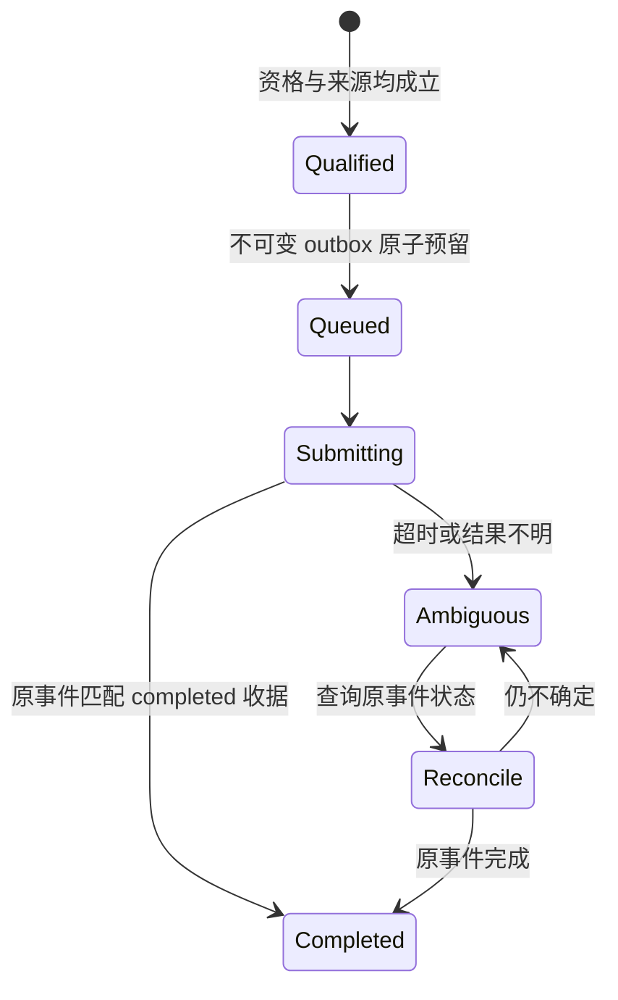

# 存入与召回

## 留存触发和资格

在实际任务或阶段形成可复用成果、已确认或修订的决定、经验证的根因/恢复经验、明确且有范围的稳定偏好或绑定交接时，正常回答准备中审查最小候选。无需等用户提醒，也不必每轮保存或另开模型调用处理空候选。

只有以下条件全部有证据支持才追加：内容已确认、在所述范围/日期/版本下稳定且可复用；项目或明确主题身份可靠；类型适合长期保存；writer/银行所有权、兼容性、来源和隐私已核实；有范围的非重复检查成立；原子本地 outbox 和冲突可见性可用。稳定不等于永不过期。

不保存会话逐字稿、隐含推理、工具/命令日志、源文件倾倒、例行进度、实时状态、猜测、秘密、受保护资料或推断的人格/全局偏好。没有候选、已有覆盖或资格不明通常静默跳过，不制造“存入完成”的措辞。

## 原始证据不能被摘要替代

在有损提取前，完整保留承重字段：项目范围、前提、条件、例外、禁止事项、权限、证据状态、来源身份、版本及可用的 hash/事件标识。摘要或索引是派生视图，不能覆盖原件。

本地 writer 的权威源文件上限为 16KiB，候选为 8–4000 字符。来源过大时，只有在现有文件写入授权内，才能制作经过原件核对的小型来源记录，保留必要原文及全部承重条件、原来源指针与 hash。不能静默截断，也不能分成一批记忆灌入；无法完整保存就跳过。

原始聊天可以作为取证来源，但不因此允许把整份聊天存入长期记忆。自动归档 worker 还要求权威项目成果等独立证据；新生成摘要或成功自报不能自己证明具备留存资格。

## 写入和恢复

queued、pending、submitting 和 ambiguous 都不能称作完成入库。完成需匹配原来的 64 位十六进制事件 ID 与 completed 收据。结果未知时查询原事件；不要换一个事件 ID 重发。若调用回执丢失，用原 scope/source hash 的确定性状态查询找回记录。

既有记录只追加，不更新、删除、合并或迁移。纠正是新记录，带清楚的原事件引用和适用条件。仅在 MCP 进程运行时排空此前已合格事件；排队协调器不会自行读聊天或创建候选。

## 召回路由

| 用户的问题 | 首选入口 | 下一步 |
| --- | --- | --- |
| “是不是讨论过某个想法？” | Notion 的项目讨论/未决问题 | 找到讨论状态与原来源；没有命中不等于从未讨论 |
| “我们最后决定了什么？” | 当前权威项目记录，其次有范围的 Hindsight 召回 | 核对来源、条件、版本及后续修订 |
| “为什么当时这样修？” | 经验证的恢复经验与原始验证物 | 区分成功步骤、失败尝试与未验证假设 |
| “这个方法怎么执行？” | 已有流程、runbook、已获准的 Skill | 核对适用环境和当前权限 |
| “文档具体怎么说？” | 明确获准的 RAGFlow 数据集或原文 | 显式传非空 dataset IDs，不扩大为全库搜索 |

路由是应遵循的工作流程，不是本仓库提供的统一自动检索服务。Notion 现有记录证明有讨论载体，不证明全部会话都已覆盖，也不证明跨工具召回已自动执行。

先使用当前上下文和权威文件；只有必要历史证据缺失时才召回，先绑定项目和记录类型。高相似度只是发现候选。涉及权限、身份、恢复、迁移等重要用途，必须核对原来源；缺一次性约束、中段修订或真实验证状态时，定向补读准确原件。无法补齐则 uncertain。

有冲突就保留冲突，不用出现频率、最新提及时间或模型置信度自动裁决。重要决定不能只靠语义搜索一次没命中就认定没有历史。
